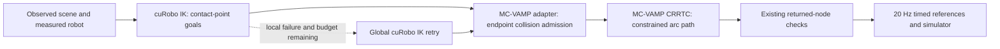

# Planner handoff and fallback audit — 2026-11-01

This is an operator audit of the current Luna service, its reachable manipulation/perception helpers, and the completed 12-episode evaluation. It is not learning material supplied to Luna. It distinguishes automatic alternatives, caller-selected modes, ordinary search, and inactive historical code. It does not claim to enumerate every internal branch of third-party libraries.

## What changed in this revision

The cuRobo arc endpoint is no longer re-solved with SciPy or projected through the native constraint solver before collision admission. cuRobo is explicitly asked for **1 mm endpoint accuracy**. Successful GPU joint values pass unchanged to read-only constraint/collision evaluation. Failed GPU seeds are reported as failed rather than repaired. The independent 0.002-radian endpoint-progress veto was removed; the Cartesian endpoint accuracy owns that tolerance.

The existing **6 mm path band** remains a separate setting: it permits deviation from the estimated hinge circle during constrained path planning. It is not the IK accuracy setting. The old implementation incorrectly reused that band as the GPU endpoint tolerance and then drove the endpoint residual almost to zero with another solver. That was our integration choice, not a cuRobo requirement.

This removes the post-cuRobo re-solve. It does **not** remove MC-VAMP's internal constrained-planning projection, its endpoint projection check, the other fallbacks below, or legacy CPU IK implementations. No collision model migration is included in this revision.

Sources: [arc endpoint adapter](/common/users/dz323/vlm_tamp/src/vlm_tamp/curobo_v2_arc.py), [configuration](/common/users/dz323/vlm_tamp/src/vlm_tamp/hinged_contact_tools.py), [arc integration and timing](/common/users/dz323/vlm_tamp/src/vlm_tamp/arc_execution.py).

## What actually plans the motion

We use `InverseKinematics.solve_pose`, not cuRobo MotionGen or its constrained trajectory planner. Importing `ToolPoseCriteria` from `motion_retargeter` configures an IK cost; it does not run a trajectory optimizer. Free approaches use VAMP RRT-Connect. The compiled MC-VAMP adapter is our planning model, not the simulator's contact oracle.

The arc constraint is the measured grip point on a circle around the estimated hinge. `point` leaves wrist rotation free subject to a jaw-tilt inequality; `jaw_axis` maintains the jaw axis with twist freedom; `rigid` constrains orientation. CRRTC explores joint configurations and projects them onto this constraint. That projection is a numerical step inside the path planner. The removed SciPy solve was a separate endpoint optimizer before that planner.

## Collision discrepancy and exact witness

The two backends start from the same observed point data, but **do not check the same geometric model**:

| Element | cuRobo arc IK | Current MC-VAMP adapter |
|---|---|---|
| Arm/environment | Stock VAMP Panda arm spheres, transformed into calibrated frames | Six calibrated convex arm-link volumes |
| Palm | Inscribed spheres approximating the palm | Calibrated convex palm |
| Fingers | All finger bodies and pads omitted | Finger bodies and pads included, with surface-specific contact permissions |
| Scene | Meshes made from point clouds: 5 mm static pitch, 2 mm moving pitch locally | Tagged points: 7.5 mm static, 5 mm moving, 3 mm contact voxel spacing |
| Moving object pose | Rotated to the requested IK angle | Rotated to progress inferred from the candidate grip point |
| Contact permissions | Cannot express the omitted fingers' selective contact policy | Grasped fingers may touch selected handle points; unrelated surfaces remain obstacles |
| Robot self-collision | Disabled in this calibrated cuRobo worker | VAMP self-collision check |

Thus copying stock VAMP arm spheres to cuRobo is **already implemented**, and is insufficient: our custom MC-VAMP environment checker no longer uses those spheres as its final arm geometry. Its numerous gripper spheres are broad-phase search aids; convex halfspaces make the final decision. Their count is not the count of physical spherical obstacles.

For full-pose grasp/free-motion IK, GPU environment checking is disabled entirely. Its results are robot-pose proposals; native endpoint/path checking follows. Controlled physical pushes also use collision-disabled point IK, under their explicit simulation execution policy described below.

Sources: [GPU sphere construction](/common/users/dz323/vlm_tamp/src/vlm_tamp/rekep_libero/curobo_collision_model.py), [GPU solver configuration](/common/users/dz323/vlm_tamp/src/vlm_tamp/rekep_libero/curobo_v2_worker.py), [native geometry adapter](/common/users/dz323/vlm_tamp/src/vlm_tamp/mcvamp_contact_numerical.py), [compiled collision checker](/common/users/dz323/vlm_tamp/src/vlm_tamp/native/mcvamp_contact_numerical.cc).

**Saved failure: opening state 36, artifact `043-arc`, measured control 584, requested continuation to 5 degrees.**

- 64 GPU candidates, 47 reported successful. All 47 were rejected by native checking for `gripper0_finger1_collision` against `observed stationary geometry`.
- We reconstructed the saved checker and tested the original GPU joint values: **0/47 passed before CPU adjustment; 0/47 passed afterward**. All 64 saved post-adjustment rejection classifications were reproduced. The CPU adjustment did not create these particular rejections.
- Original successful seed 32 contains **two stationary-labeled points inside finger 1**, at depths **0.608–3.914 mm**, with **zero added convex collision padding**. They are 16.8–26.1 mm from selected-contact samples, so the selected-handle exemption does not apply.
- Those points are only **1.99 and 4.80 mm from the current moving-part cloud**. A partition/ownership error is a plausible explanation, not yet proved. Neither this numerical overlap nor its visualization proves a real simulator collision.
- Robot frame agreement was approximately 0.00018 mm. The evidence points to geometry/permission/partition differences, not a coordinate-frame calibration mismatch.

[Original-versus-adjusted audit](/common/users/dz323/vlm_tamp/results/luna-broader-evaluation-20261101/pose-handoff-audit.json) · [exact witness coordinates](/common/users/dz323/vlm_tamp/results/luna-broader-evaluation-20261101/finger-overlap-witness.json)

GraspGen passing the initial hand check does not cover this later state: that check used the open hand at the initial grasp pose. This rejection uses the measured post-closure aperture, a new arm/hand pose, and subsequently updated/transported scene geometry. GraspGen generates the grasp proposal; our scene checker performs that initial collision test. It is not a guarantee for every subsequent door angle.

## Global retry: exact behavior and cost

Default `curobo_v2_global_fallback=True`. If local continuation fails to find an admissible endpoint or connection with at least three seconds left, the adapter destroys the local IK scope, configures global endpoint IK, and requests the final arc endpoint from the original reference posture. Up to eight admitted goals are connected by **MC-VAMP CRRTC over the whole arc**. The failed local partial arc is not executed.

Local IK uses 64 nearby seeds, 0.02-radian perturbations, a previous-posture reference, no LM global seed solver, and no early seed-only exit. Global IK restores the upstream seed solver, changes the posture/velocity objective, and recreates its optimizer between queries. Global settings retain a **zero-joint seed prior** with weight 0.01; local mode disables it. This is a meaningful objective change, not merely “try again.”

In the audited failure, local GPU work took about **0.145 s**, CPU equality polishing **0.450 s**, and the global GPU query **13.395 s**. Total search was **16.579 s despite a nominal 10 s budget**. The GPU RPC cannot currently be interrupted at that local deadline; the adapter notices the expiration afterward. The final global attempt examined no returned seeds before the deadline check. Also, its summary overwrites local candidate counts, which can make an earlier 64-candidate search look like “zero goals.” Both remain known reporting/budget issues, not proof of infeasibility.

In the completed 12-episode batch: **six global retries, one solved**. This is not an ablation demonstrating benefit. Source: [retry branch](/common/users/dz323/vlm_tamp/src/vlm_tamp/curobo_v2_arc.py), [trigger](/common/users/dz323/vlm_tamp/src/vlm_tamp/partial_pose_arc.py), [batch usage](/common/users/dz323/vlm_tamp/results/luna-broader-evaluation-20261101/fallback-usage-audit.json).

## Automatic alternatives and hidden adjustments still present

“Present” means reachable in the current service; it does not mean it ran in every episode. These were not removed merely to make this audit shorter.

| ID | Trigger and behavior | Status, cost, and evidence |
|---|---|---|
| A1 | Failed local arc → global IK + full MC-VAMP connection | Default on; six uses/one solved in this batch. Can overrun local time budget. Described above. |
| A2 | Full-pose IK returns `success=false` → CPU FK/bounds/self-collision tests can still admit its joint values | Present in `TaskIK.solve_many`; no CPU optimizer here, but it overrides the GPU status. 66 logged full-pose queries admitted zero failed-flag candidates in this batch. |
| A3 | Full-pose and controlled-contact IK values outside bounds → clip to configured joint bounds, then evaluate FK/self-collision | Present in `TaskIK.solve_many` and `solve_contact`; this changes returned joints. The new arc endpoint adapter does neither clipping nor failed-seed rescue. Contact IK also does not require the GPU success flag; its telemetry does not establish how often that mattered. |
| A4 | Arc candidate handed to native path planner → endpoint projection check, then internal CRRTC projection | Present in `NativeScene.plan`; pre-check rejects a projection changing any joint by over 0.01 rad. Internal projection remains part of constrained planning. Separate from the removed SciPy handoff. |
| A5 | Native arc path succeeds → Python checks returned nodes again for scene/constraint/wrist admission | Still present for local and global arc paths. This is duplicate checking of returned nodes, not an added denser interpolation pass. The native C++ adapter's extra dense pass is removed. |
| A6 | Grasp endpoints happen to be free of target contact → use a no-target-contact approach context; otherwise use contact-enabled approach context | Present in `graspgen_selection.select_direct_grasp`; one route per learned pose. This changes allowed target contact based on endpoints. No second geometric grasp proposal is generated. |
| A7 | Controlled push reaches insertion/stroke → make environment predictions advisory and use one-seed point IK plus physical feedback | Default for controlled physical pushing, even when free approach uses `collision_policy=veto`. This was introduced under the user's request to let contact pushes execute in simulation. Self/bounds checks remain. This differs from ordinary free-motion collision checking. |
| A8 | Next controlled-push increment has no solution or planning time expires → return and execute an already found reachable prefix | Present when `allow_partial=True`; the remaining requested distance is not magically completed. Reports include `reachable_prefix`; raw `all_commands_issued` only means all submitted prefix commands were issued. |
| A9 | Controlled-push trajectory exceeds remaining controls → execute a prefix fitting the remaining controls | Present in contact skill execution. Ordinary `execute`/arc/sequence requests still require their complete submitted trajectory to fit. |
| A10 | `continue_push`/`push_stroke` has no retained current contact → create a current-hand reference with no associated object or scene | Automatic on missing/stale active contact. It can move the hand without contact acquisition or tracking an object. It does not establish engagement. `push_stroke` is an alias of this interface. |
| A11 | Candidate contact is within 6 mm of the current contact landmark → reuse current hand posture instead of approach search | Present in contact acquisition. Proximity is not physical-contact evidence. Exact-state previews and already retained contacts are also reused. |
| A12 | Object tracking fails and reference views are missing → capture extra views and retry fit | Present in contact skill feedback, once per control state under its remaining budget. Controlled push only expands a recoverable missing-view case; not an unlimited retry loop. |
| A13 | Controlled push has unresolved object motion → retain uncertainty and use measured hand motion to continue/stop | Present. No invented object rotation or task success; object/joint-linked requests and hook/release have stricter engagement semantics. This is why a hand stroke can run without confirmed object progress. |
| A14 | Target moved during approach → update from observed motion and plan local reinsertion | Present in contact skills; geometry correction and a new insertion cost time. Non-controlled modes with collision veto stop if displacement exceeds 8 cm; non-controlled acquisition also stops on unresolved motion. Controlled push can proceed using hand feedback. |
| A15 | Requested handle fit fails with `HandleFitError` → return door-only grounding | Present. It explicitly reports the missing handle and does not manufacture a handle. Other exceptions propagate. |
| A16 | Sequence starts with an insufficiently open hand → open physically and redo grasp approach selection | Present when `execute_sequence` is chosen. More control/search cost; returns failure if fresh selection fails. |
| A17 | `execute_sequence(calibrate_joint=True)` → initial small arcs, automatic motion-based hinge fit and later-motion verification; replace old hinge if supported and better | Default **within that explicitly selected tool**. This is numerical automatic calibration, not Luna independently inventing a hinge revision. One of two sequence executions enabled it in this batch. The unsigned axis keeps the previous sign. |
| A18 | Gripper command encounters measured joint-limit overshoot → request an inward arm correction | Present in `gripper_arm_reference`; can move the arm while the user thinks only the gripper is changing. Nominal increment 0.05 rad at 20 Hz/1 rad/s, then real joint-bound clipping and controller slew limit. No simulator teleport. |
| A19 | Robot controller reference exceeds slew limit → rate-limit the reference | Present, 1 rad/s maximum. Timing resamples geometric segments at 20 Hz and adds requested endpoint holds. Command completion does not prove arrival. |
| A20 | Feature detector provides too few points → add deterministic spaced mask samples | Present in `part_motion.query_points`; same query set for LK/CoTracker. No automatic change from a failed selected tracker to a different learned model. |
| A21 | Motion appears stationary → use observed stationary-pose evidence instead of claiming a hinge motion | Present in `RGBDHingeTracker`. Does not certify task completion; preserves zero-motion evidence. |
| A22 | Luna ends its turn before success/budget → resume the same actor thread with remaining-budget reminder | Present in evaluation harness; no extra motor budget or strategy recipe. Zero resumed turns in this batch. Nonzero runtime exit is reported rather than silently retried. |

Sources: [IK adapter](/common/users/dz323/vlm_tamp/src/vlm_tamp/rekep_libero/task_ik_curobo.py), [native adapter](/common/users/dz323/vlm_tamp/src/vlm_tamp/mcvamp_contact_numerical.py), [grasp selection](/common/users/dz323/vlm_tamp/src/vlm_tamp/graspgen_selection.py), [contact search and strokes](/common/users/dz323/vlm_tamp/src/vlm_tamp/contact_skills.py), [skill execution](/common/users/dz323/vlm_tamp/src/vlm_tamp/contact_skill_service.py), [retained contact](/common/users/dz323/vlm_tamp/src/vlm_tamp/push_contact_state.py), [robot service](/common/users/dz323/vlm_tamp/scripts/serve_subscription_robot.py), [sequence execution](/common/users/dz323/vlm_tamp/src/vlm_tamp/sequence_execution.py), [joint calibration](/common/users/dz323/vlm_tamp/src/vlm_tamp/joint_feedback.py), [timing](/common/users/dz323/vlm_tamp/src/vlm_tamp/timed_execution.py), [feature queries](/common/users/dz323/vlm_tamp/src/vlm_tamp/part_motion.py), [tracker](/common/users/dz323/vlm_tamp/src/vlm_tamp/rigid_hinge_tracking.py), [actor persistence](/common/users/dz323/vlm_tamp/src/vlm_tamp/episode_persistence.py).

## Caller-selected alternatives and ordinary searches

| ID | Behavior | Scope |
|---|---|---|
| B1 | `collision_policy=advisory` removes observed environment points from that planning context; simulator collisions stay active | Caller opt-in for free/contact planning. Push/hook acquisition tries observed-clear preference before the robot-only alternative; hook spends up to half its search allowance preferring observed-clear contact. No explicit advisory request appeared in this batch. A7's internal controlled-push policy is separate and was active. |
| B2 | Hook/push-and-release stroke fails at current orientation → try wrist orientations ±15°, ±30° about motion and ±10° about a transverse axis | Present for non-controlled stroke modes. Controlled physical push bypasses this menu and uses soft-orientation cuRobo point continuation. |
| B3 | Region contact search tries up to five observed points, calibrated finger/edge landmarks, orientations and standoffs | Normal candidate search, but can be expensive. Multiple standoff/target IK batches and up-to-two-second approach searches occur inside the search budget. Not a single “direction → push” operation. `continue_push` bypasses acquisition. |
| B4 | `plan_contact_pose` with no quaternion uses current wrist and ±45° around each world axis for each contact landmark | Current, uses **cuRobo full-pose IK**, not `TaskIK.solve_point`. Tries one closest scene-valid path per candidate. This corrects the initial suspicion that this public tool used CPU point IK. |
| B5 | `plan_pose` tries successive returned IK branches until a path succeeds | Current; each path request can have eight seconds. It has no single aggregate deadline in this helper. Different from the small GraspGen selector's one path per pose. |
| B6 | `initial_image_direction_xy=null` delegates sign inference to adjacent observed depth / upright-door prior | Explicit caller delegation. Otherwise caller image hint and depth evidence are compared; a conflict is reported. Motion fit alone cannot identify “opening” versus “closing.” |
| B7 | `apply_joint_estimate(allow_unverified=True)` installs a provisional fit; `reuse_fixed_joint=True` reuses a historical fixed hinge; explicit `motion_sign` changes axis sign | Caller opt-in. Three unverified applications requested in this batch. `motion_sign` can reverse the meaning of positive arc commands; no automatic task-goal verification repairs it. Known reporting defect: the existing-handle branch still returns `direction_preserved=True` even when an explicit sign was supplied; that field cannot establish semantic preservation. |
| B8 | `plan_arc` caller can change geometric/orientation tolerance, grasp mode, wrist bound and search duration | Explicit request, not an automatic relaxation ladder. The new GPU 1 mm endpoint setting is separate from public path tolerance. |
| B9 | Sequence recovers by suggesting inspect, push, regrasp, refresh, shorter feedback intervals | These strings are supplied tool knowledge shown to Luna. They are not automatic actions and must not be counted as independent learner discoveries. Contact-skill errors also supply recovery suggestions. |

Sources: [surface-pose tools](/common/users/dz323/vlm_tamp/src/vlm_tamp/surface_contact_tools.py), [contact skills](/common/users/dz323/vlm_tamp/src/vlm_tamp/contact_skills.py), [direction grounding](/common/users/dz323/vlm_tamp/src/vlm_tamp/handle_contact.py), [public service](/common/users/dz323/vlm_tamp/scripts/serve_subscription_robot.py).

## Preprocessing, stops and error handling that also affect results

- **Current-robot point removal:** removes observed points inside actual measured robot volumes, with zero padding, before planning. Authorized earlier. It does not clear points under proposed future robot poses. [Implementation](/common/users/dz323/vlm_tamp/src/vlm_tamp/current_robot_scene.py).
- **Contact and point ownership:** proximity/masks assign static, moving and selected-contact roles. Grasped fingers can contact selected handle points; fingertip push permits pads/distal finger portions on the target while proximal fingers/palm/arm remain checked during collision-veto planning. Push can slide over its selected moving part. These are geometric associations, not simulator object identities. [Rules](/common/users/dz323/vlm_tamp/src/vlm_tamp/contact_collision_evidence.py).
- **Scene transport:** RGB-D mode does not replace a failed object fit with predicted hand motion. It retains an unresolved/stale scene. A separate hand-prediction configuration exists but was not the active batch mode. Rebuild failures restore the old scene transaction and rethrow; they do not claim an update succeeded. [Transport](/common/users/dz323/vlm_tamp/src/vlm_tamp/scene_pose_sync.py).
- **Sequence stops:** unobserved target motion after approach stops automatic closure; near-empty gripper evidence, loss of engagement, two ineffective arcs, incomplete next plan or budget exhaustion return to Luna. Explicit gripper/manual tools still exist. Gap-based grasp feedback can be `unknown` without an associated handle radius; no tactile/force inference is substituted.
- **Physical push stops:** measured hand stall and native success can terminate before all references. Ordinary execution does not add an online geometry veto. Hook/push-and-release have engagement and withdrawal stages; advisory release can continue despite unresolved object-motion feedback. After withdrawal, release issues 20 hold controls to advance one second of physics, unless normal native-success termination stops it. Physical disengagement is not certified. [Physical feedback](/common/users/dz323/vlm_tamp/src/vlm_tamp/push_execution_feedback.py).
- **Upstream IK internals:** the pinned cuRobo solver uses its LM seed stage for full/global IK and its configured particle/L-BFGS optimizer sequence if necessary. Local arc/contact continuation disables global LM seeding and early seed-only exit. These are GPU IK internals, not a second SciPy solve or a cuRobo trajectory plan.
- **Compatibility edits:** the worker supplies a Warp namespace alias and translates obsolete particle-optimizer YAML cost names. They preserve a working objective instead of silently dropping costs. Numerical errors destroy affected GPU graphs and propagate; there is no CPU retry on GPU crash.
- **Budget/quality gates:** 600 physical controls/1800 wall seconds remain; reset spends 60 controls. Grasp approach budgeting reserves requested closure/holds, not an extra manipulation buffer. The full-arc API requires a complete arc; controlled push may return a prefix. A 3 mm general pose-IK tolerance remains outside the new 1 mm arc endpoint setting.
- **Infrastructure:** capacity waits and watchdog stops do not switch policy/model/planner. A failed child is recorded. The completed panel used 12 fresh Luna/high actors with no inherited learner guidelines. A manual infrastructure rerun is a separate run, not successful-task evidence.

## Historical alternatives still in the repository, inactive in this Luna configuration

| Code | What remains | Why it is not the current route |
|---|---|---|
| `PartialPoseArc.project`, `PalmClearanceObjective`, `partial_goals`, legacy branches of `full_arc_plan` | SciPy point/jaw solves, palm-clearance objective, random posture seeds, global/beam continuation | Current `arc_goal_backend=curobo_v2` with local continuation returns through the GPU proposer. No CPU fallback on its failure. |
| `TaskIK.solve_point` | Two-seed SciPy point solver with soft orientation | Retained for older placement callers; current public `plan_contact_pose` uses the full-pose GPU menu in B4. It is **not** the post-cuRobo arc solve removed here. |
| `hinged_contact_tools.select_grasp` old branch; `coupled_pipeline.grasp_poses` | Frontal/oblique/learned pose mixing, re-grounded translations, depth/anchor menus, advisory best-candidate fallback | Current `grasp_selection_method=graspgen_direct` returns before this branch. Current batch uses eight unmodified learned proposals plus fixed robot-frame conversion. |
| `contact_plan` endpoint-menu branch; `goal_candidates` | Aligned-jaw then tilted-jaw alternatives, terminal posture projection, quaternion menu | Current `planning_backend=partial_pose_arc` bypasses them. |
| `shared_contact_planning`, `reliable_mechanisms`, `physical_execution` | Older pinch/press-drag/push or placement recovery pipelines | Not called by the current Luna robot-service operations. |
| `handle_contact.local_contact_ik`, `ObservedRobotScene` bracing/panel-band fallback | Local SciPy pose compliance, prior panel band and palm-brace allowances | Older execution/checking helpers, not the current native arc or direct GraspGen route. |
| `CoupledResources.grounding` cache/API route | RGB-verified cached grounding, then external perception call | Current Luna supplies its own region selections to `ground`; this old baseline grounding method is not used. |
| Alternate cuRobo v1 backend, DINO tools, legacy frozen-grasp replay | Explicit alternate configurations/diagnostic tools | Not automatic replacement of the current v2/Luna evaluation. |

## Validation and remaining discrepancy

Targeted tests: **46 passed, 2 skipped**. The skips require a historical retained Panda calibration fixture; the current saved-scene native/GPU test below ran on the 4090.

The actual GPU test loads the saved observed scene, requests 1 mm accuracy, and asserts every candidate handed off equals the original GPU result. It executes no simulator controls and supplies no information to Luna:

| Requested local endpoint | GPU-successful seeds | Largest GPU-success position error | Native connection |
|---|---:|---:|---|
| 2.5° | 43 | 0.342 mm | Solved, 25 ms; two distinct admitted goals |
| 5° | 46 | 0.119 mm | All 46 rejected for finger 1 vs stationary points |

Post-GPU re-solve time: **zero**. Cold first IK query: 1.32 s; next query: 0.142 s. Observed GPU memory peaked at 618 MiB at five-second sampling; that is not an exact instantaneous peak. The check ran under the 16 GiB/no-swap limit. Memory pressure was zero and post-test I/O pressure was near zero. No physical-task success improvement is claimed.

The first numerical-test setup omitted the saved robot geometry when reconstructing its scene; it failed before arc IK. That helper setup was corrected, the failed artifact was preserved, and the successful check is explicitly `r2`.

[GPU/native regression](/common/users/dz323/vlm_tamp/results/arc-unmodified-ik-check-r2-20261101/result.json) · [candidate records](/common/users/dz323/vlm_tamp/results/arc-unmodified-ik-check-r2-20261101/curobo-v2-queries.json)

**Alignment remains unresolved.** The required fix is one robot geometry/contact-policy description and one observed-world interpretation consumed by both backends. If using spheres, both must consume the same calibrated arm/palm/proximal-finger/pad spheres and identical per-surface permissions; merely removing fingers is too broad. Both also need the same moving/static partition, scene discretization and motion transform. The two witness points need their role checked against observed motion before deciding whether to retag them. Removing the re-solve alone does not address any of these differences. No extra fallback or collision relaxation was added to hide this outstanding disagreement.
