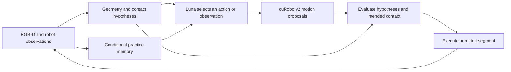

# Planning with uncertain grasps, geometry and contact — 22 October 2026

The user selected cuRobo v2 as the next motion-generation backend and requested
this literature review before migration. This is a focused review of primary
research, with assumptions checked against the current repository. It is not an
exhaustive survey or a novelty determination. No planner, learner prompt, memory
bundle, sensor interface or experiment was changed during this review.

## Main finding

There is substantial prior work on precisely these uncertainties. The most
useful distinction is between estimating what might be true, finding an action
that tolerates those possibilities, and deliberately taking an action that will
make the next decision better informed. Recovery after an unexpected outcome is
another capability; it does not by itself implement the other three.

For our project, the closest connections are TAMPURA for decisions under
uncertainty, forceful manipulation planning for grasp retention, online
articulation estimation for hinge repair, and plan ensembles for combining
geometric planning with learned decisions. Autonomous skill practice also has
direct precedents. The papers below explain where these connections hold and
where their assumptions differ from ours.

## What uncertainty means in this implementation

| Unknown quantity | Why a nominal plan can fail | Relevant distinction |
|---|---|---|
| Hinge position/axis and door pose | A feasible hand arc may disagree with the actual articulation | Estimation error, including biased or multiple plausible models |
| Grasp/contact mode | The hand may move while the handle slips or remains stationary | Discrete alternatives such as retained contact, sliding and disengagement |
| Friction, grip force and required opening wrench | A reachable grasp may not transmit enough force/torque | Mechanics and action-outcome uncertainty |
| Scene geometry and object ownership | Occluded surfaces or misclassified moving points invalidate clearance | Unknown space and segmentation uncertainty, not just noisy depth |
| Robot tracking and calibration | Executed geometry differs from planned geometry | Robot-state error, often correlated over a trajectory |

The code currently represents these only partially:

- [The public robot state](../scripts/serve_subscription_robot.py) exports joint
  positions, end-effector pose and gripper positions. `capture()` adds RGB-D,
  calibration and sensor-derived world points. The current public interface
  does not expose a force/torque or tactile stream.
- [RGB-D hinge tracking](../src/vlm_tamp/rigid_hinge_tracking.py) estimates upright
  rigid motion. Its bootstrap spread is explicitly geometric stability, not
  calibrated uncertainty.
- [Hinge sensitivity](../src/vlm_tamp/hinge_uncertainty.py) perturbs the model and
  measures displacement. It explicitly does not estimate collision probability.
- [Scene synchronization](../src/vlm_tamp/scene_pose_sync.py) distinguishes
  observed motion from hand-based prediction. The latter explicitly assumes
  contact retention. This is a hypothesis, not an attachment measurement.
- [Native planning admission](../src/vlm_tamp/mcvamp_contact_numerical.py) checks
  modeled robot/observed-cloud geometry with bounded finger/target permissions.
  Its metadata says unobserved space is unmodeled, door/environment collisions
  are not checked, and sampled path checking is not a continuous collision
  certificate. Intended contact must remain distinct from unwanted collision.

Consequently, the present system has point estimates, provenance and sensitivity
diagnostics; it does not maintain a calibrated joint belief over these unknowns.
The [recovery review](recovery_pipeline_review_20261021.md) documents why
hand-motion prediction and measured object motion must remain distinguishable.

## Closest papers and what to take from them

### 1. TAMPURA — Curtis et al., RSS 2024

[Partially Observable Task and Motion Planning with Uncertainty and Risk
Awareness](https://arxiv.org/html/2403.10454v2) learns outcome distributions for
temporally extended controllers and plans over an abstract belief-state MDP.
Information gathering and undesirable outcomes enter the decision problem.
This is the closest high-level architecture reference for deciding among
observe, manipulate and recover. However, engineers supply the controllers,
belief representation, update functions and abstractions. It is not a generic
uncertainty wrapper: the paper reports substantial planning costs, and real
experiments use known object meshes. See Sections III–V and VII–VIII.
[Author code](https://github.com/aidan-curtis/tampura) is available; it has not
been installed or reproduced here.

### 2. Forceful manipulation — Holladay, Lozano-Pérez and Rodriguez

[Robust Planning for Multi-stage Forceful
Manipulation](https://arxiv.org/html/2208.00319v2), revised 2023, augments TAMP with
frictional contact and actuator torque constraints. It samples uncertain
friction, contact geometry and task wrenches to score stability and choose
strategies. This directly addresses a gap in geometric arc feasibility:
whether a grasp can transmit the forces needed throughout the task. The model
assumes slow, quasi-static operations and requires contact/load models and
parameter perturbations. Its robustness scoring is not an online slip observer.
For us, adapting the stability test is more relevant than reproducing its
bottle-opening strategies. See Sections 5 and 7.2.

### 3. CC-VPSTO — Brudermüller et al., 2024–2026

[Chance-Constrained Via-Point-Based Stochastic Trajectory
Optimisation](https://arxiv.org/html/2402.01370v4) evaluates sampled uncertainty
rollouts inside trajectory optimization. It supports multimodal uncertainty
and addresses finite-sample bias. Crucially, testing a trajectory on the same
samples used to optimize it does not automatically validate its risk; Section
4.4 discusses independent validation and repeated-testing corrections. The
reported physical experiment runs at 3 Hz with 100 samples, but models a
stochastic moving obstacle and ignores measurement noise. This is a useful
recipe for an outer uncertainty layer, not evidence of that rate or grasp
retention on our task. Reviewed version: 6 April 2026, especially Sections 4
and 6.3.

### 4. SCORA — Dawson et al., 2023 preprint

[Chance-Constrained Trajectory Optimization for High-DOF Robots in Uncertain
Environments](https://arxiv.org/pdf/2302.00122) considers both obstacle-position
uncertainty and robot tracking error. It optimizes risk allocation using
geometric collision-risk bounds. Its formulation assumes Gaussian tracking
errors with known covariance and Gaussian translations of convex obstacles.
This is a clean collision-risk reference, but unknown shapes, articulation and
lost-grasp modes exceed that model. A single covariance would be a poor
representation of separated “still grasped” and “disengaged” hypotheses. See
Sections III–V; experimental evidence is simulation.

### 5. Online articulation estimation — Buchanan et al., 2024 and 2026

[Online Estimation and Manipulation of Articulated
Objects](https://arxiv.org/html/2601.01438v1) extends the authors'
[ICRA 2024 work](https://arxiv.org/abs/2309.16343). It combines learned visual
priors, kinematic measurements and a force factor in a factor graph, updating
the articulation during opening. This is directly relevant to our hinge model.
The 2026 system uses a human-selected grasp point and wrist force sensing;
its kinematic factor assumes a rigid grasp, allowing small slip through tuned
measurement noise. Therefore it does not solve arbitrary contact loss. We can
borrow the estimator structure, but cannot interpret hand motion as object
motion unconditionally. See Sections 6.3–6.4 and 7.

### 6. Gripper encoders as evidence — Zhou et al., RA-L 2017

[A Probabilistic Planning Framework for Planar Grasping Under
Uncertainty](https://www.ri.cmu.edu/app/uploads/2017/06/main_revised_v2.pdf)
plans sequences of grasps and uses post-grasp finger spacing to update a
particle belief. An offline tree branches on encoder observations. This is
especially useful because our interface already exposes gripper positions:
additional tactile hardware is not the only possible source of contact
evidence. However, this paper assumes known object/gripper geometry, bounded
initial pose uncertainty and quasi-static planar mechanics. A width reading
can distinguish some hypotheses; it does not independently prove that our
handle remains securely grasped during a pull. See Sections II and IV–VI.

### 7. Plan ensembles for articulated manipulation — Chamzas et al., 2023

[Meta-Policy Learning over Plan Ensembles for Robust Articulated Object
Manipulation](https://arxiv.org/pdf/2307.04040) constructs plans for different
environment hypotheses and learns which path policy to follow from observation
history. It is an unusually close comparator: the experiment pushes a cabinet
door with a simulated Franka. The learned selector uses data from 1,000
episodes; its features include the door joint value, and geometry is known.
Those inputs differ from our sensor-only actor. It establishes that combining
multiple geometric plans with learned selection is already prior art, while
leaving a distinct question about adaptation through language memory without
training a task-specific selector. See Sections III–IV.

### 8. Choosing what to practice — Kumar et al., 2024

[Practice Makes Perfect: Planning to Learn Skill Parameter
Policies](https://arxiv.org/html/2402.15025v2) estimates skill competence,
extrapolates possible improvement and selects practice according to future
task usefulness. It demonstrates autonomous practice without resets. This
addresses our earlier question of how to decide what Luna needs to learn.
It starts with specified skills/operators, detectors, low-dimensional features
and parameter priors; it learns parameter policies rather than textual memory.
The transferable idea is to measure which missing capability limits task
success and practice that capability. The strongest comparison would control
practice budget and task distribution. See Section III and the limitations in
Section VI; [project](https://ees.csail.mit.edu/).

### 9. Uncertain point-cloud models — Gualtieri and Platt, RA-L 2021

[Robotic Pick-and-Place With Uncertain Object Instance Segmentation and Shape
Completion](https://pmc.ncbi.nlm.nih.gov/articles/PMC8022832/) propagates
perceptual uncertainty into regrasp-planning costs and compares sampled and
learned success estimates. This is a close reference for our point-cloud
pipeline: inferred or segmented surfaces should not all carry equal evidential
weight. Its move/open/close setting assumes successful closure fixes an object
rigidly and avoids dynamic actions. Thus it does not cover pulling an
articulated handle under uncertain retention. See Sections III–V and VII.
[Author code](https://github.com/mgualti/GeomPickPlace) is available but untested
in our environment.

## Additional foundations worth retaining

| Paper | Useful idea | Boundary for this project |
|---|---|---|
| [Berenson et al., Task Space Regions under pose uncertainty, IROS 2009](https://personalrobotics.cs.washington.edu/publications/berenson2009tsruncertainty.pdf) | Find goals satisfying task requirements across pose hypotheses; reject impossible robust goal sets early | Geometric uncertainty treatment does not establish grasp mechanics; useful before expensive goal search |
| [Garrett et al., Online Replanning in Belief Space, ICRA 2020](https://arxiv.org/pdf/1911.04577) | Interleave observation and action, update beliefs, reuse the remaining plan structure | Uses a determinized approximation; not full contingent risk optimization |
| [Koval et al., Pre- and Post-Contact Policy Decomposition, RSS 2014](https://publications.ri.cmu.edu/storage/publications/pub_files/2014/7/koval2013precontact_rss.pdf) | Separate pre-contact motion from a tactile policy over contact beliefs | Planar pushing, binary contact feedback and offline policy computation |
| [Mahler et al., Dex-Net 2.0, RSS 2017](https://arxiv.org/pdf/1703.09312) | Score grasps under pose/friction uncertainty using analytic labels and learned predictions | Pick/lift grasp quality is not a task-conditioned handle-retention guarantee |
| [Shirai et al., Chance-Constrained Optimization in Contact-Rich Systems, 2022](https://arxiv.org/pdf/2203.02616) | Treat uncertain contact and state evolution jointly using stochastic complementarity and mixed-integer optimization | Requires a suitable dynamics formulation; simulation results do not establish tractability for our full scene |
| [Jankowski et al., Robust Pushing, 2024](https://arxiv.org/html/2404.02795v2) | Choose contact motions whose predicted effect reduces configuration variance | Planar, quasi-static experiments; the paper explicitly identifies enclosing grasps as violating its high-stiffness assumption |
| [Saund and Berenson, Contact Sensing Uncertainty, ISER 2018](https://www.bradsaund.com/file/MotionPlanningforManipulatorsinUnknownEnvironmentswithContactSensingUncertainty.pdf) | Collision Hypothesis Sets retain ambiguity about where an unseen obstacle caused contact | Uses torque-based contact detection and tolerable exploratory collisions; neither is an established actor capability here |

These are complementary approaches. Robust planning tries to work across an
uncertainty set. Chance-constrained planning controls a modeled probability of
violation. Belief-space planning also reasons about what future observations
will reveal. A controller can compensate for error without explicitly doing any
of those calculations. “Works under uncertainty” therefore needs a precise
definition in our experiments.

## Where cuRobo v2 fits

The [cuRoboV2 technical report](https://arxiv.org/html/2603.05493v2) describes
GPU depth fusion/TSDF–ESDF construction, collision-aware motion generation and
dynamics/torque-aware optimization. Its formulation does not supply a posterior
over hinge or contact modes, a slip observer, or a chance-constrained grasp
retention planner. External-force differentiation is not by itself a model of
which contacts will persist. Accordingly, our proposed role for it is numerical
motion generation and geometric evaluation inside a broader decision loop.
This is an architectural interpretation of the report, not a claim that these
extensions could never be built with its components.

An ESDF answers distance queries for a represented world. A fused distance value
or fusion weight must not be silently interpreted as a calibrated probability
of collision. An uncertainty layer must specify which scene hypotheses the map
represents, how unknown space is handled, and how the manipulated part moves.
The [mapping review](collision_mapping_tools_20261022.md) records the existing
v1 smoke tests; none of those tests establishes v2 performance or uncertainty
handling.

## Proposed design for our next experiments

The following is a project proposal, not an implemented algorithm or a claim
of novelty.

Start with an explicit distinction between uncertain geometry and uncertain
attachment. Keep a small set of coherent hinge/door/contact hypotheses, with
measurement provenance and timestamps. When visual tracking fails, preserve
both retained-contact and disengaged possibilities instead of allowing hand
prediction to become an observation. Uncalibrated alternatives should be called
hypotheses or sensitivity cases, not assigned invented probabilities.

Evaluate the **same proposed action** across the plausible worlds. Generating
one successful plan per world is insufficient if the robot does not know which
world it occupies. A hinge error affects the entire moving part and persists
over the trajectory; it should not become independent noise on every point or
waypoint. Geometry checks can use a GPU backend, but predicting retention or
slip requires an additional mechanical or learned outcome model. Moving-object
and intended-contact semantics still need an explicit implementation.

Use short action/observation cycles when evidence warrants them, accounting for
their time and control-step cost. Fresh views, gripper spacing and disagreement
between observed object motion and hand motion can help discriminate hypotheses.
Without force sensing, some explanations remain indistinguishable; the interface
should expose that fact. A future tactile/force condition must be evaluated
separately from the present sensor-only condition.

Keep numerical belief updates, geometry and risk calculations in tools. Luna can
receive compact evidence such as the observation source, unresolved contact
hypotheses, model disagreement, and candidate performance on specified test
cases. Its role is to select useful observations/actions and learn conditional
strategies from practice. It should not estimate precise probabilities by
reading joint-angle lists or narrating confidence.

Separate transient scene belief from persistent skill memory. A candidate
memory should record an observable trigger, action/parameter choice, expected
observation, successful and failed trials, scope, and tool version. It should
not preserve a development scene's coordinates as a general solution. No
separate reflection reviewer is proposed; Luna's existing self-practice loop
can write these records.

If we later claim a chance constraint, define the event clearly, for example
the probability of **any unintended collision during the executed segment**.
Per-waypoint thresholds do not automatically provide a trajectory bound.
Calibrate the uncertainty model and validate candidates on independent samples;
account for repeated selection/testing. Until then, report empirical robustness
across declared perturbations rather than a numerical safety guarantee.

## Evaluation that would distinguish the contributions

First benchmark the v2 backend on identical saved inputs, preserving the
constraint/contact meaning. Then freeze that backend for the uncertainty and
learning comparisons. Otherwise faster planning can be mistaken for better
reasoning or better memory.

| Condition | Purpose |
|---|---|
| Nominal geometry + fixed generic policy | Baseline with the new numerical backend |
| Multiple hypotheses + same fixed policy | Isolate numerical uncertainty handling |
| Multiple hypotheses + fixed observation/recovery heuristic | Test whether simple feedback rules explain the gain |
| Multiple hypotheses + Luna, no newly learned memory | Measure the model's contribution with identical tools |
| Same Luna/tools + frozen self-practice memory | Isolate the value of practice and retained experience |

Use held-out initial states and, for a transfer claim, held-out articulated
objects/task families. Independently vary perception error/occlusion, actual
geometry, tracking error, and physical friction/contact disturbances; changing
a planner estimate is different from changing the physical scene. Keep true
hinges, contact labels and native object angles evaluator-private. Register
equal action, wall-time and practice budgets.

Measure native success, unintended contact severity, loss/recovery of effective
contact, progress under model disagreement, observation cost and end-to-end
latency. Evaluate belief calibration only against a declared event and
independent evaluation evidence. The profiler should separate sensing/map
updates, belief updates, scenario evaluation, IK, motion search, grasp/contact
evaluation, execution and model-call overhead.

The current five successful clean resets of development state 45 are useful
engineering evidence, but do not establish robustness to these uncertainties
or generalization; see the [practice report](compact_luna_practice_20261022.md).

The research question worth testing is whether a frozen inexpensive language
model can acquire transferable, evidence-grounded choices about observing,
probing, manipulating and recovering through practice and external memory,
given strong numerical tools. Existing belief planning, robust grasping and
plan-selection methods are relevant baselines. Simply combining an LLM,
multiple plans and cuRobo would not by itself establish a new contribution.

## Reading order and continuation

Read TAMPURA for the decision architecture, Holladay et al. for the physical
meaning of grasp feasibility, and Chamzas et al. for the closest planner/learner
comparison. Follow with Buchanan et al. for articulation estimation, CC-VPSTO
for statistical validation, and Practice Makes Perfect for practice allocation.

Review complete. The next engineering work is the already-selected isolated
cuRobo v2 migration benchmark. The uncertainty architecture and comparison
conditions above are proposals to develop after that baseline is measured;
they are not prerequisites for switching the numerical backend.
